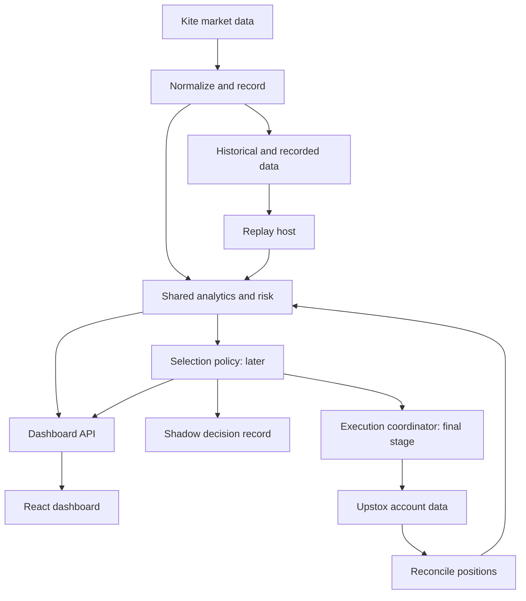

# AutoTrader — System Components and Project Boundaries

Updated: 9 October 2026 | Status: documented design; no application implemented

## Dashboard-first decision

The first user-facing product is a live dashboard that helps Jeevan make and monitor manual intraday trading decisions. Build its minimum data pipeline and recorder alongside it. The dashboard must be useful before automated selection exists.

Build order: manual dashboard with recording → historical replay and selection research → live shadow recommendations → automated execution. This replaces the earlier replay-first ordering. Replay correctness, realistic costs and unseen evaluation still apply before trusting automated recommendations.

Manual means the user decides and places orders in the broker app. The first dashboard has no broker-order submission capability. It can journal plans, show read-only actual positions when connected, calculate risk/cost estimates, and issue informational alerts. Automatic exits are part of the later execution project.

## Custom UI confirmed

The dashboard will be our own application, serving personal manual trading and a frontend portfolio. D00 reviews the product references for useful patterns; it is not a gate to choose an external dashboard. The project map below remains the implementation plan, created incrementally.

The React project owns reusable panels, linked charts/tables, layouts, mode/connection states, alerts, journal and later replay/shadow views. Shared .NET analytics/risk owns financial calculations. Portfolio evidence includes responsive/accessibility behaviour, measured update performance and end-to-end workflow verification. Use labelled fixtures for a reproducible demo; keep live data access and recording as separately verified integrations.

## Components and C# projects

These are logical boundaries in one repository, not a requirement for independently deployed microservices. Create projects incrementally. Start with one .NET API host, a React app and small libraries; separate a recorder host only when its lifecycle warrants it.

| Component | Suggested project/path | What belongs here | First needed |
| --- | --- | --- | --- |
| Shared market model | src/Trading.Domain | Internal contract IDs, provider mappings, expiry/strike/lot/tick validity, quotes, bars, positions, timestamps and quality flags | Dashboard |
| Provider adapters | src/Trading.Data | Kite live quotes; Upstox historical/optional enrichment; canonical identity mapping; reconnect and normalization; source provenance | Dashboard |
| Feed and recorder host | src/Trading.Recorder | Subscription lifecycle, normalized quote cache, bar building, bounded buffers, raw retention, gap/quality reports | Dashboard; can initially run inside API host |
| Shared features | src/Trading.Analytics | Futures/bank VWAP, opening range, returns, bank participation, OI changes, scoped PCR, data sufficiency | Dashboard |
| Planning/risk calculator | src/Trading.Risk | Fee assumptions, lot/cash checks, bid/ask marks, planned risk and scenario calculations; later hard gates | Dashboard |
| Positions and journal | src/Trading.Portfolio | Read-only Upstox positions/fills/funds, periodic reconciliation, manual/paper trade records, notes, actual versus hypothetical state | Dashboard; manual journal works without account access |
| Events and context | src/Trading.Context | Manually entered or verified events, release times, impact tags, source links, macro/FII-DII observations and as-of dates | Dashboard basic event list; automated ingestion later |
| Alert rules | src/Trading.Alerts | Price/condition/data-health alerts, cooldowns, state transitions and acknowledgement history | Dashboard |
| Backend read API | src/Trading.Api | REST snapshots, SignalR deltas, dashboard queries, journal/config writes; no order endpoint initially | Dashboard |
| User interface | ui/trading-dashboard | Live overview, linked charts, bank table, option comparison, trade plan, position monitor, alerts and journal | Dashboard |
| Decision policy | src/Trading.Engine | Setup detection, candidate generation/ranking, rejection reasons and hold/exit policy using shared analytics/risk | Research stage |
| Historical host | src/Trading.Replay | Historical import, simulated clock, chronological playback, candidate logs and hypothetical fill/accounting evaluation | Research stage |
| Evaluation reports | src/Trading.Research | Frozen-policy runs, cost/delay stress, feature ablations, chronological holdouts and performance reports; initially part of Replay | Research stage |
| Live shadow host | src/Trading.Shadow | Engine on live inputs, recorded recommendations and comparison with manual decisions; no orders | After historical evaluation |
| Execution coordinator | src/Trading.Execution | Upstox order lifecycle, quantity/margin gates, partial fills, failed legs, recovery, protective exits, kill switch and account reconciliation | Final stage |
| Verification | tests/Trading.Tests | Time alignment, feature fixtures, accounting, stale data, reconnects, isolation of future events, read-only boundaries and UI flows | Throughout |

Trading.Analytics and Trading.Risk are reused by the dashboard and engine. Do not implement one version in JavaScript and another in C#. The UI formats values and handles user interaction; the backend owns financially meaningful calculations.

## Data flow

The execution coordinator also needs current account-state and independent risk checks; a selection result alone never authorizes an order. Upstox supplies actual execution/account truth. Kite quote marks remain estimates and may differ from the execution venue's available price.

## Deployment for one user

Use a local .NET host and React UI on a laptop initially. Keep broker secrets and tokens in the backend. Store configuration and journal records durably; append market observations to files with schema/version metadata. Use PostgreSQL when query and accounting needs justify it. Kafka, Redis and Kubernetes are not prerequisites.

The recorder receives market updates independently of the browser's refresh rate. The API coalesces display updates so price changes do not constantly reorder rows. A proposed 250–500 ms display interval is a configurable starting point, not a validated performance claim. Alerts evaluate according to their own event/bar semantics, not the UI timer. Record source, receipt and render timestamps to measure latency.

A heartbeat proves the connection exists, not that each instrument is current. Show connection state, instrument quote age, last trade age, bank-weight coverage and recording gaps separately. Quiet instruments can have old last-trade times while quoted bids/offers continue to update.

## Four work packages

| Package | Deliverable | Completion evidence |
| --- | --- | --- |
| A: manual cockpit | Live Bank Nifty, futures and bank view; liquid option comparison; trade planning, journal, alerts and recording | One recorded real session; freshness visible; user can compare options and monitor a manual trade |
| B: research engine | Replay, explicit policy, simulator and evaluation reports, displayed in the same dashboard | Determinism, no future leakage, cost reconciliation and untouched evaluation |
| C: shadow mode | Engine recommendations alongside live market/account state | Recorded latency, parity with replay features, no broker orders |
| D: execution | Automated entries/exits and reconciled position lifecycle | Agreed daily loss budget and tested failure/recovery behaviour |

Do not block Package A on obtaining a complete September dataset, choosing an ML model, or validating an entry strategy. Do block live claims on working data access: a mock screen must visibly say SYNTHETIC or DEMO.

## Known dependencies

API credentials and entitlements have not been tested. Historical constituent weights and expired contract coverage remain unverified. Current membership/weights must be obtained for live use; replay requires historical definitions. Lot sizes, expiry calendars and fee schedules must be loaded, not copied from past trade examples.

See [06-DASHBOARD-SPECIFICATION.md](06-DASHBOARD-SPECIFICATION.md) for user-facing panels and prioritization, and [04-DEVELOPMENT-BACKLOG.md](04-DEVELOPMENT-BACKLOG.md) for tasks.
